  

  
  
  
  

---

### Sobre Mim

Graduando em **Sistemas de Informação pela Universidade Federal da Paraíba (UFPB)** e integrante do **Projeto Simba (Petrobras)**, com atuação voltada para **Engenharia de Inteligência Artificial, Backend e Automação de Processos**.

Construo soluções que conectam modelos de linguagem, recuperação estruturada de informações e fluxos operacionais confiáveis. Minha frente de trabalho concentra-se em **arquiteturas RAG**, processamento de documentos, **execução local de LLMs** e avaliação contínua da qualidade de aplicações baseadas em IA, aliada à infraestrutura e APIs necessárias para colocá-las em produção de forma escalável.

---

### Áreas de Atuação & Engenharia

| Frente | Foco Técnico |
| :--- | :--- |
| **Engenharia de IA & RAG** | Arquiteturas RAG, recuperação híbrida, BM25, embeddings, *Contextual Retrieval* e avaliação de LLMs. |
| **Agentes & LLMs Locais** | Ollama, modelos Qwen, integração com ferramentas externas (*tool calling*) e assistentes baseados em contexto (Obsidian). |
| **Backend & Automação** | Python, FastAPI, Node.js, Java (Spring Boot), APIs REST e orquestração de workflows inteligentes com **n8n**. |
| **Infraestrutura & DevOps** | Docker, servidores domésticos (*homelab*), Linux, GitHub Actions, CI/CD e acesso remoto seguro com Tailscale. |
| **Engenharia de Dados** | Pipelines ETL, modelagem dimensional, *Star Schema* e bancos relacionais / em memória (PostgreSQL, MySQL, Redis). |
| **Redes & Segurança** | Análise de tráfego com Wireshark e `tcpdump`, além de estudos de análise estática de segurança (SAST). |

---

### Projetos em Destaque

| Projeto | Arquitetura & Tecnologias | Links |
| :--- | :--- | :--- |
| **Artemis 2.0 — Virtual AI Assistant** | Assistente virtual em tempo real com **React, Tailwind CSS, FastAPI, Google Gemini e WebSockets**. | [Galeria 3D](https://matheusele.github.io/portfolio/artemis.html) • [Repositório](https://github.com/MATHEUSele/chat-estudos-Artemis) |
| **Portfólio & Demos Interativas** | Showcase interativo com simulações ao vivo da **Stack Python** e **Chatbot WhatsApp**. | [Acessar Portfólio](https://matheusele.github.io/portfolio/) • [Demo Python](https://matheusele.github.io/portfolio/python.html) • [Demo WhatsApp](https://matheusele.github.io/portfolio/whatsapp.html) • [Repositório](https://github.com/MATHEUSele/portfolio) |
| **Hermes — Sistema de Pedidos** | Sistema prático para agendamento de pedidos em restaurantes com baixo/nulo custo de implantação (**TypeScript**). | [Repositório](https://github.com/MATHEUSele/restaurante-pedidos-sistema-hermes) |
| **Zeus — Explosões Solares (NASA API)** | Workflow automatizado em **n8n** que consulta a API da NASA e consolida eventos solares no Google Sheets. | [Repositório](https://github.com/MATHEUSele/explo-es-solares-n8n-zeus) |
| **Atena, ML & Análise de Dados** | Automação em Python, princípios de Machine Learning e notebooks de análise exploratória com Pandas. | [Bot Atena](https://github.com/MATHEUSele/bot-automa-o-atena) • [ML Principles](https://github.com/MATHEUSele/machine-learning-principles) • [Análise de Dados](https://github.com/MATHEUSele/analiseDe-dados) |

---

### Stack Tecnológica

| Categoria | Tecnologias |
| :--- | :--- |
| **Linguagens** | `Python` `TypeScript` `JavaScript` `Java` `SQL` `Bash` `PowerShell` |
| **IA & LLMOps** | `RAG` `LangChain` `Ollama` `Google Gemini` `Embeddings` `BM25` `Contextual Retrieval` |
| **Backend & APIs** | `FastAPI` `Node.js` `Spring Boot` `WebSockets` `APIs REST` |
| **Frontend** | `React` `Tailwind CSS` `HTML5` `CSS3` |
| **Automação** | `n8n` `Workflows de IA` `Web Scraping` `Extração de PDFs` |
| **Dados & Bancos** | `PostgreSQL` `MySQL` `Redis` `Pandas` `ETL` `Star Schema` |
| **Infra, Qualidade & Redes** | `Docker` `Linux` `Git` `GitHub Actions` `Cypress` `Postman` `Tailscale` `Wireshark` `tcpdump` |

---

### GitHub em Números

  
  

---

  © Matheus E. L. Eleoterio • Transformando dados, IA e automação em sistemas confiáveis.

